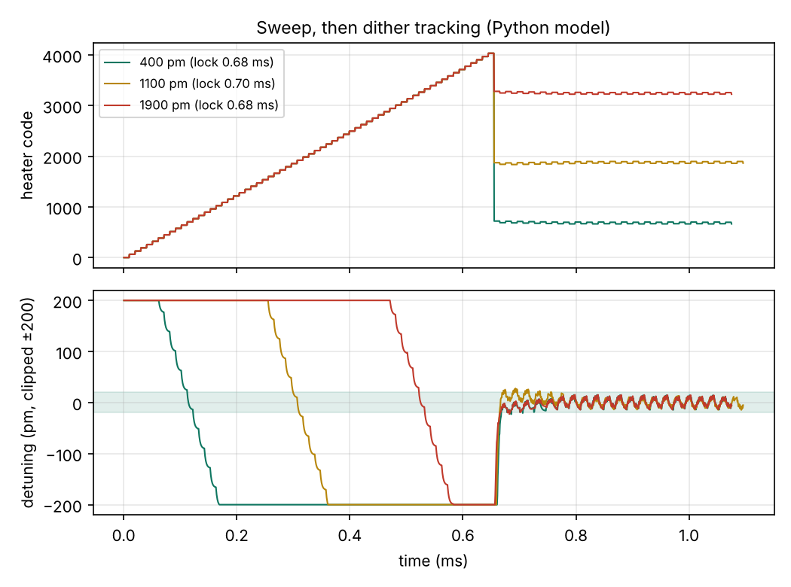
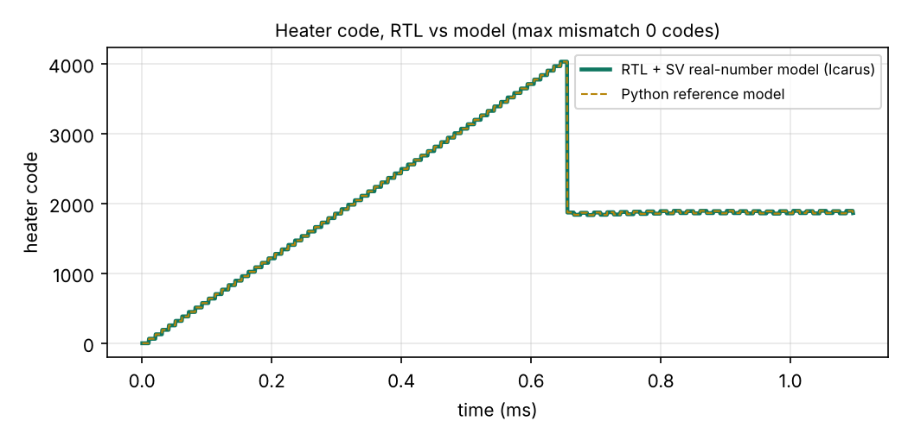
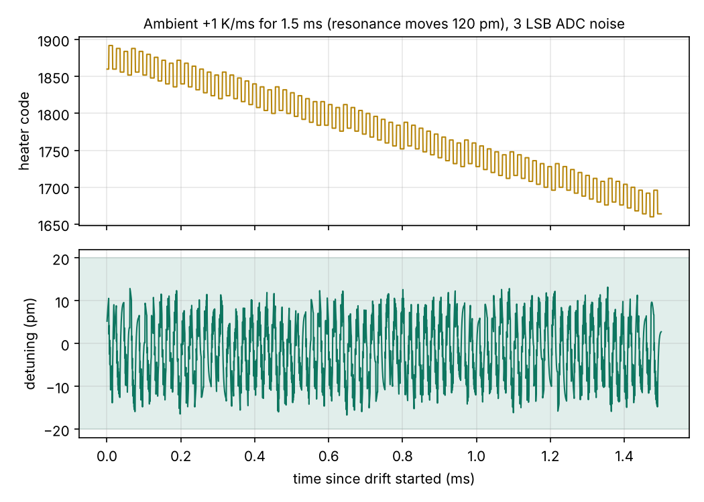
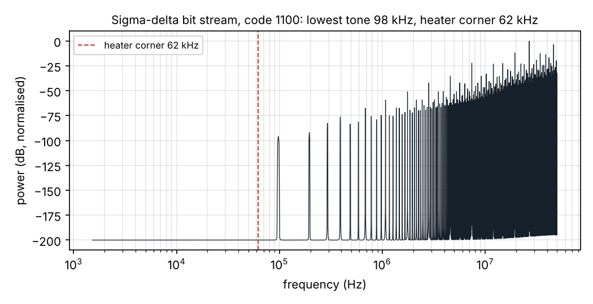
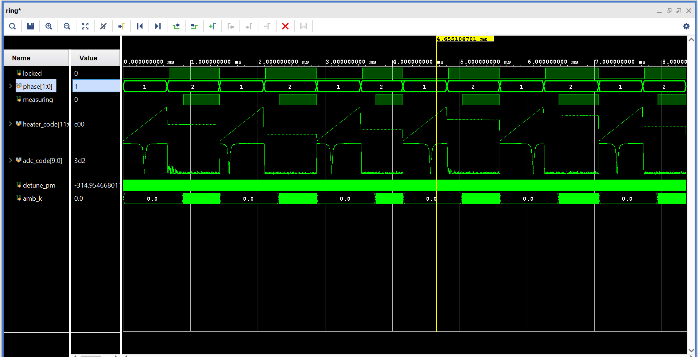

# Micro-Ring Thermal Tuning Loop: Digital Controller, Sigma-Delta Heater DAC and Real-Number Model

[](https://github.com/Mahendr99ar/ring-tuning-rnm/actions/workflows/ci.yml)


Author: [Mahendra Meena](https://github.com/Mahendr99ar)

Silicon photonic transceivers use micro-ring resonators to modulate or filter light. A ring
only works when its resonance sits right on the laser wavelength, and the resonance moves with
temperature, about 80 pm per kelvin for silicon. The linewidth is only around 100 pm, so a
change of one or two degrees on the chip is enough to break the link. Each ring therefore has a
small heater and a digital loop that finds the resonance at start-up and then keeps it there as
the chip heats up and cools down.

This project builds that loop and verifies it the way mixed-signal blocks are verified in
industry: the digital part is synthesizable RTL, and the analog part (heater, ring, photodiode,
ADC) is a SystemVerilog real-number model. A Python model of the same system is the reference
and is also used to study behaviour that would be slow to simulate in RTL.

```
                  DIGITAL (synthesizable RTL)                          ANALOG (real-number model)
 ┌────────────────────────────────────────────────────────┐   ┌──────────────────────────────────────────────┐
 │  ring_tuner                     sigma_delta_dac          │   │  heater: thermal low-pass (2.56 µs)           │
 │  sweep -> find minimum   code   12-bit, 1st order        │bit│  ring:   shift = 80 pm/K x (heater + ambient) │
 │  dither +/-16, step 4  ───────► error feedback   ───────►│──►│          Lorentzian dip, 100 pm FWHM, 90 %    │
 │  lock detect                                             │   │  PD+ADC: 10 bit, every 64 clocks, + noise     │
 │        ▲                                                 │   │                         │                     │
 └────────┼─────────────────────────────────────────────────┘   └─────────────────────────┼─────────────────────┘
          └──────────────────────────────── adc_code (through-port power) ◄─────────────┘
```



## How the controller works

At resonance the light leaves through the ring, so the through-port photodiode reads its lowest
value. The controller looks for that minimum.

1. **Sweep.** Step the heater code from 0 to 4095 in steps of 64. After each step wait 512 clocks
   (two thermal time constants), then average 8 ADC samples. Remember the code with the lowest
   reading.
2. **Track.** Go to that code and dither: measure at centre + 16 and centre − 16, then move the
   centre 4 codes toward the lower reading. This repeats forever, so slow temperature changes are
   followed.
3. **Lock.** `locked` is high while tracking and the lower reading is within 40 ADC codes of the
   best reading from the sweep.

The heater is driven by a first-order sigma-delta DAC: one adder and one register turn the 12-bit
code into a 1-bit stream whose average is code / 4096. The heater's thermal time constant does the
low-pass filtering, so no analog DAC is needed.

## Verification

| Part | What it does |
|------|--------------|
| Real-number model (`tb/rnm`) | Heater filter, ambient drift, Lorentzian ring, photodiode and 10-bit ADC with Gaussian noise, all in SystemVerilog `real` |
| Directed test (CI) | Six scenarios on Icarus: three laser offsets, drift up, drift down, noisy ADC |
| UVM | Scenario driver sets the analog conditions, monitor measures lock time and true detuning, scoreboard checks the requirements, coverage on offset, drift, noise and lock time |
| Assertions | Heater stays inside the dither window, tracking steps are at most 4 codes, `locked` only while tracking |
| Python model (`model/`) | Same plant and algorithm, clock by clock; plots, drift-limit study, and a check against the RTL trace |

Requirements and how each is checked: [docs/verification_plan.md](docs/verification_plan.md)

## Results

**RTL + real-number model (Icarus, runs in CI).** All six scenarios pass. Tracking error is
measured on the true detuning inside the model.

| Scenario | Lock time | Mean \|detuning\| | Max \|detuning\| |
|----------|-----------|-------------------|------------------|
| Offset 400 pm | 0.68 ms | 6.2 pm | 15.2 pm |
| Offset 1100 pm | 0.70 ms | 6.6 pm | 16.6 pm |
| Offset 1900 pm | 0.68 ms | 6.4 pm | 15.3 pm |
| Ambient +1 K/ms for 1.5 ms (resonance moves 120 pm) | 0.70 ms | 6.3 pm | 17.9 pm |
| Ambient −1 K/ms for 1.5 ms | 0.70 ms | 6.8 pm | 18.8 pm |
| ADC noise 3 LSB | 0.70 ms | 6.5 pm | 16.6 pm |

Most of the remaining error is the dither itself: ±16 codes is ±9.4 pm.

When the tracking direction is flipped on purpose in the RTL, the test fails with 57 pm and
84 pm of detuning and a loss of lock.

**RTL against the Python model.** With the same settings and no noise, the heater code from the
RTL simulation and from the Python model match at all 3426 sampled points (every 64 clocks), and
both report lock on the same sample. The true detuning differs by 1.9 pm on average and 8.2 pm at
most. The largest difference is right after the heater jumps from 4032 back to 1872 at the end of
the sweep, where the resonance moves about 5 pm per clock, so a one or two clock difference in when
the trace is sampled shows up.



**How fast can the loop follow drift?** Each decision moves the heater 4 codes (2.3 pm) and
takes about 22 µs. In the Python model the worst detuning stays at 15.7 to 18.2 pm up to 1.4 K/ms,
then jumps to 34 pm at 1.6 K/ms and 83 pm at 2.0 K/ms. Across 144 runs with drift up to ±1 K/ms,
three offsets and up to 2 LSB of noise, the worst detuning was 20.4 pm, so I set the requirement at
25 pm, a quarter of the linewidth.



**Sigma-delta.** Over 65 536 clocks the bit density for code 1100 is 0.26855, the same as
1100 / 4096. A first-order modulator produces tones instead of smooth noise. For code 1100 the
lowest tone is at 98 kHz, just above the heater's 62 kHz corner. Codes whose pattern repeats every
4096 clocks put a tone at 24 kHz, below the corner, so the heater ripple grows for those codes.



**Synthesis (Yosys, generic cells, runs in CI).** `ring_tuner_top` is 929 cells and 119
flip-flops. The full report is in `results/yosys_ring_tuner_top.txt`.

**UVM in Vivado 2025.2 (xsim, UVM 1.2).** All three tests pass with 0 UVM errors. Each
scenario resets the controller, puts the laser at a random offset from the cold resonance,
waits for lock, then measures the true detuning in the plant model during a 300–600 us
tracking window while the ambient temperature drifts.

| Test | Scenarios | Drift (mK/ms) | ADC noise | Lock time | Worst detuning | Result |
|------|-----------|---------------|-----------|-----------|----------------|--------|
| `ring_lock_test` | 5 | 0 | 0–2 LSB | 0.676–0.696 ms | 17.2 pm | PASSED |
| `ring_drift_test` | 6 | -616 to +898 | 0–2 LSB | 0.676–0.696 ms | 17.6 pm | PASSED |
| `ring_noise_test` | 4 | -172 to +153 | 3–4 LSB | 0.676–0.696 ms | 17.5 pm | PASSED |

All 15 scenarios stay under the 25 pm requirement with about 7 pm of margin. The mean
detuning is 6.3–6.6 pm in every scenario. The UVM numbers agree with the Python model
(15–19 pm worst case below 1.4 K/ms).

Scenario coverage (offset, drift and noise bins, lock-time bins, offset x drift):
`ring_lock_test` 57.8%, `ring_drift_test` 84.4% (drift 100%), `ring_noise_test` 60.0%. The
offset x drift cross is not closed yet. With 15 scenarios total, some of the 9 cross bins
were not hit, and adding more scenarios to `ring_drift_test` is the next step.

### Waveform: `ring_drift_test` in Vivado



Six scenarios back to back, 8.4 ms in total. `heater_code` and `adc_code` are drawn in
analog style.
- `phase` 1 is the sweep. The heater code ramps up, and the photodiode reading (`adc_code`)
  drops sharply where the heated ring passes through the laser line. That dip is what the
  controller is looking for.
- The heater then jumps back to the code where the dip was, `phase` goes to 2 (track) and
  `locked` goes high. `adc_code` stays low from here on, which means the ring is sitting on
  the laser line.
- `measuring` marks the tracking window the scoreboard scores. In the fifth scenario
  (about 5.4–6.6 ms, drift +898 mK/ms) you can see the heater code slope down: the room is
  warming the ring, so the controller backs the heater off to stay on resonance.
- `detune_pm` and `amb_k` are left in digital style. Before lock the detuning swings over
  more than 2000 pm, which would flatten the in-lock part to a line.

Full log: [`docs/vivado_regression_log.txt`](docs/vivado_regression_log.txt)

### A testbench bug: the drift test never drifted

The first Vivado run passed all three tests, but the log showed `drift 0 mK/ms` in every
scenario, including all six in `ring_drift_test`, whose range was ±1000. Its first five
scenarios were also the same as in `ring_lock_test`. Coverage said the same thing: the drift
coverpoint was stuck at 33.3%, only the "none" bin.

The cause was one line in the item class:

```systemverilog
constraint c_drift { soft drift_mk_per_ms == 0; drift_mk_per_ms inside {[-1000:1000]}; }
```

A soft constraint is only dropped when it conflicts with a hard one. The test's inline
constraint was `drift_mk_per_ms inside {[drift_min:drift_max]}`, and 0 is inside that range,
so there was no conflict and the solver kept picking 0. I removed the soft default (the
sequence already defaults the range to 0..0). After the fix, `ring_drift_test` ran drifts from
-616 to +898 mK/ms, the ambient moved by up to 0.54 K during tracking, and drift coverage went
to 100%.

What I took from it: a green test means nothing until you check that the stimulus you asked
for actually reached the DUT. The coverage report caught it, but only because I read it.


## How to run

**Vivado GUI (UVM)**
1. **Tools → Run Tcl Script…** and pick `sim/create_vivado_project.tcl`
2. **Run Simulation → Run Behavioral Simulation** (runs `ring_lock_test`)
3. Other tests: set `xsim.simulate.xsim.more_options` to
   `-testplusarg UVM_TESTNAME=ring_drift_test` or `ring_noise_test`

Each scenario simulates about 1.5 to 2.5 ms of real time, so these tests take a few minutes.

**Free tools**
```bash
make lint        # Verilator -Wall
make directed    # RTL + real-number model, 6 scenarios (Icarus)
make synth       # Yosys
make model       # Python model, plots in docs/, RTL correlation (needs numpy, matplotlib)
```

## Project structure

```
ring-tuning-rnm/
├── rtl/
│   ├── ring_tuner.sv          sweep, dither tracking, lock detect
│   ├── sigma_delta_dac.sv     first-order heater DAC
│   └── ring_tuner_top.sv
├── tb/
│   ├── rnm/ring_plant_rnm.sv  heater, ring, photodiode, ADC as real numbers
│   ├── directed/              six scenarios (CI); +TRACE writes results/trace_rtl.csv
│   └── uvm/                   interface, items, driver, monitor, scoreboard, tests, SVA
├── model/ring_model.py        Python reference model, plots, RTL correlation
├── docs/                      plots, verification plan
├── results/                   Yosys report, RTL trace
└── sim/                       Vivado scripts
```

## Limitations and next steps

- The plant is a first-order thermal model with one ring and no thermal crosstalk between rings.
- The sweep always covers the full heater range. If the range is more than one free spectral
  range, the loop could lock to the wrong resonance order; that is not modelled.
- First-order sigma-delta tones can fall below the heater corner for some codes. A second-order
  modulator or a little dither on the code would spread them out.
- Next: a Verilog-A model of the heater driver for a Spectre co-simulation, and running the
  controller through the implementation flow in my
  [asic-impl-flow](https://github.com/Mahendr99ar/asic-impl-flow) project.
